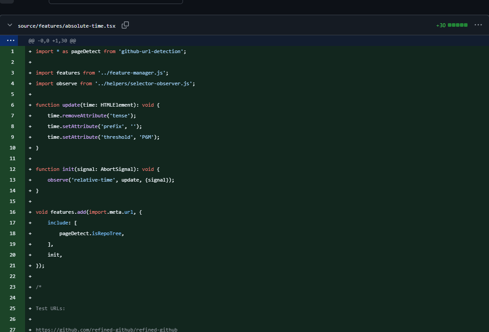

# Full Width New PR Files

[](https://github.com/aviram-shubeili/full-width-new-pr-files/actions/workflows/ci.yml)
[](LICENSE)
[](https://github.com/aviram-shubeili/full-width-new-pr-files/releases/latest)

A small Chrome Manifest V3 extension that removes the unused left pane from
newly added files in GitHub's split pull request diffs. The new file fills the
available width. Modified and deleted files retain their normal split view.



## Features

- Expands new files automatically in **Split** view.
- Supports GitHub's classic and React diff renderers.
- Handles late-loaded files and navigation between GitHub pages.
- Keeps line numbers, syntax highlighting, and review controls.
- Works with light and dark GitHub themes.
- Runs locally with no account, configuration, analytics, or network requests.

## Install in Chrome

1. Download `full-width-new-pr-files-v1.0.0.zip` from the
   [latest release](https://github.com/aviram-shubeili/full-width-new-pr-files/releases/latest).
2. Extract the ZIP to a folder you will keep on your computer.
3. Open `chrome://extensions` and turn on **Developer mode** (top right).
4. Click **Load unpacked** and select the extracted `extension` folder.
5. Reload your GitHub pull request and use **Split** diff view.

You can also clone this repository and load its `extension/` folder directly.
Node.js and the development dependencies are only needed for testing and packaging.

There is no build step, account, popup, or configuration. The extension applies
automatically, including when GitHub loads more files or replaces a diff.
To turn it off, disable it on Chrome's extensions page and reload the PR.

To update, extract a newer release, replace the files in your installed extension
folder, click **Reload** on its card in `chrome://extensions`, and reload the PR.

## GitHub Enterprise

GitHub.com and hosted `*.ghe.com` domains are included. For a self-hosted GitHub
Enterprise instance, add your instance's origin to `content_scripts[0].matches`
in `extension/manifest.json`, for example `https://github.company.example/*`.
Then click **Reload** on the extension's card and reload the PR.

## How it works

The content script checks GitHub's split diff tables for the explicit empty
base-file hunk (`@@ -0,0 +… @@`) and verifies that all left-side code cells are
empty. It hides the unused cells and columns and adjusts header/comment spans
without recreating GitHub's code or review controls. Added lines in an existing
file do not qualify. Unified diffs, binary files, and image diffs are untouched.

The extension makes no network requests, collects no data, and requests no
extension API permissions. Chrome grants its content scripts access to the
listed sites. Both the classic and React table-based diff renderers are
supported; future GitHub markup changes may require an update.

## Verify

Use Node.js 22 or later:

```sh
npm ci
npx playwright install chromium
npm run check
npm test
npm run package
```

On Linux, use `npx playwright install --with-deps chromium` to install system
dependencies as well. Packaging writes a verified ZIP to `dist/`.

Tests use Chrome to check rendered widths, untouched modified/deleted/unified
diffs, late-loaded files, review rows, and navigation/restoration.

The implementation was also checked on a live public GitHub PR containing
both a newly added file and additions-only edits to existing files. React
markup was inspected on the corresponding public commit page and verified
under a simulated PR route. Set `LIVE_PR=1` to include these network checks.

CI runs the local fixture tests and packaging on Windows and Linux. The live
checks are optional because they depend on GitHub's current public pages.

## Contributing

See [CONTRIBUTING.md](CONTRIBUTING.md) for development and release instructions.
Report bugs or suggest improvements through
[GitHub Issues](https://github.com/aviram-shubeili/full-width-new-pr-files/issues).

## License

[MIT](LICENSE) — copyright 2026 Aviram Shubeili.

This is an independent project and is not affiliated with GitHub or Google.
